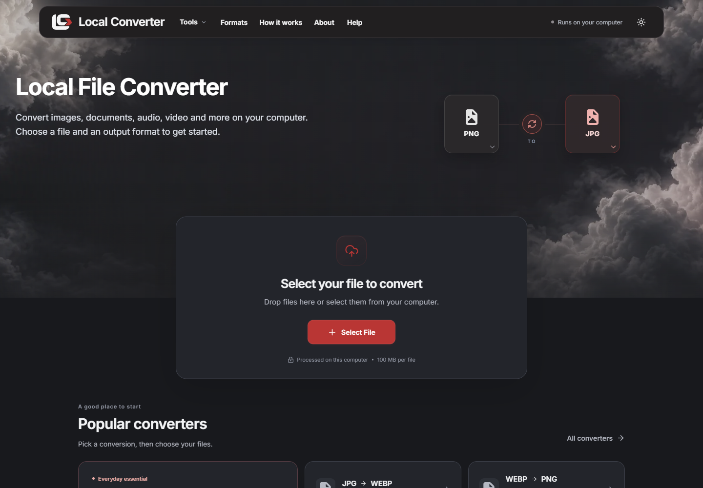
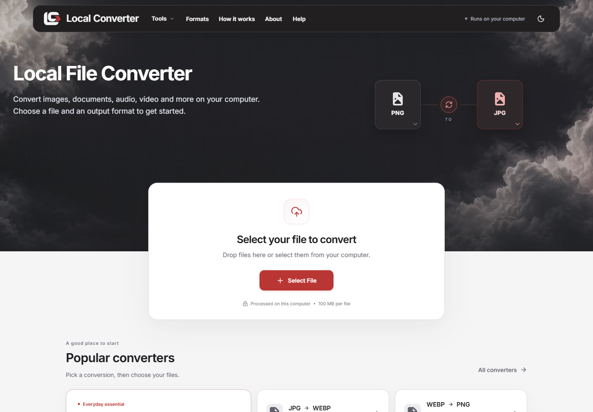
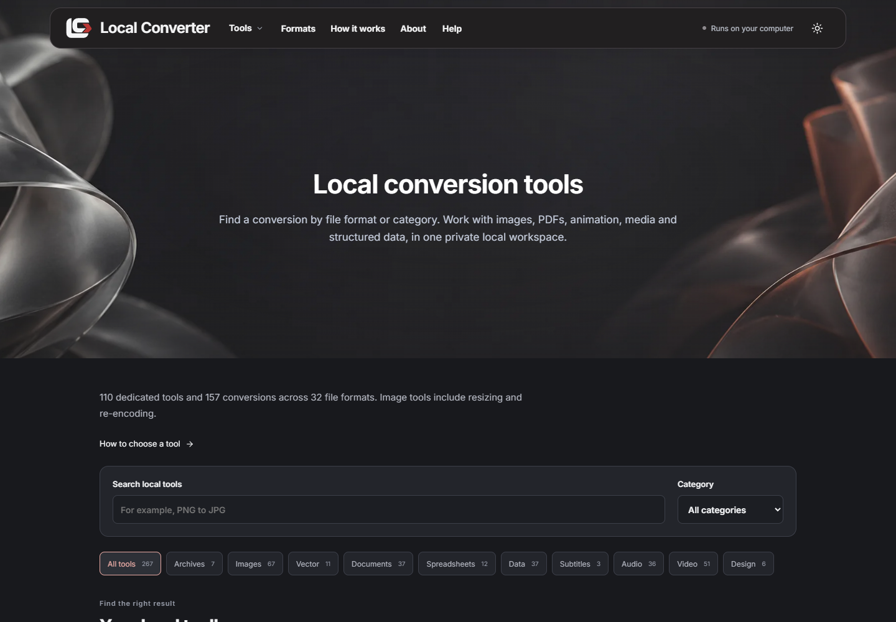
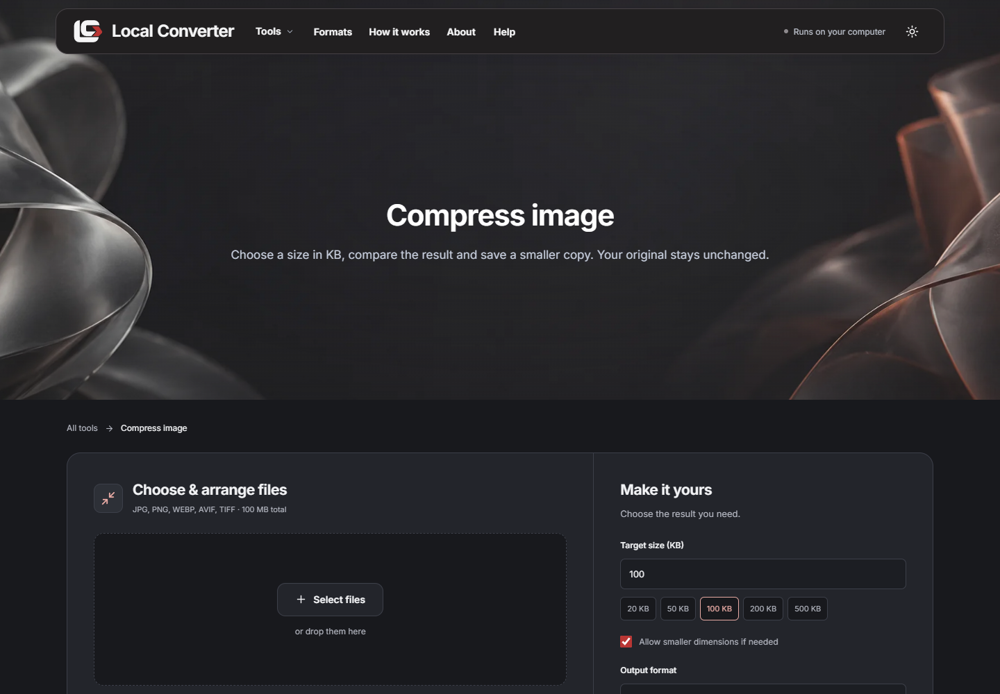
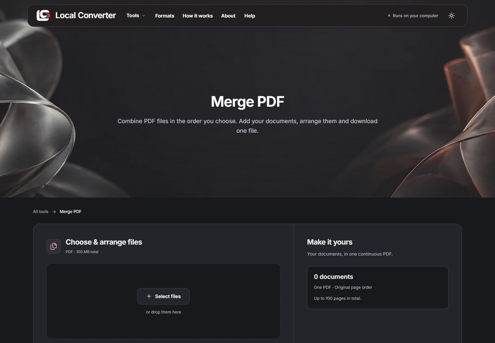
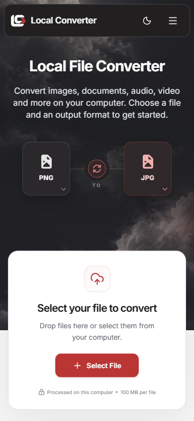
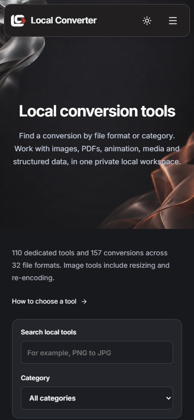

# Local Converter


**Convert files in your browser. Keep them on your device.**

[Open website](https://localconverter.tech/) · [Browse tools](https://localconverter.tech/tools) · [Supported formats](https://localconverter.tech/formats)



A browser-based workspace for image, PDF, document, audio, video and data conversion, plus everyday developer tools. The existing registry includes **110 tool workspaces** and **157 format-pair routes**. Processing uses JavaScript, WebAssembly and workers on the visitor's device; no conversion server or account is required.

## Features

| Workspace          | Examples                                                                             |
| ------------------ | ------------------------------------------------------------------------------------ |
| Images             | Convert, resize, compress, crop, inspect metadata and prepare print images.          |
| PDF and documents  | Merge, split, reorder, render, extract text, OCR and convert supported documents.    |
| Audio and video    | Convert, trim, normalize, extract audio, create GIFs and transcribe supported media. |
| Developer tools    | JSON, CSV, YAML, TOML, QR/barcodes, UUIDs, text utilities and formatting.            |
| Archives and fonts | Supported ZIP/TAR/gzip workflows and browser font conversion.                        |

Each workspace explains supported inputs, output settings and format limitations. See [supported formats](docs/supported-formats.md) and [browser architecture](docs/browser-only.md).

## Screenshots

Real application screens from the browser-only development preview. No mock data or fabricated conversion results are shown.

<table>
  <tr>
    <td><br /><strong>Light theme</strong></td>
    <td><br /><strong>Tools directory</strong></td>
  </tr>
  <tr>
    <td><br /><strong>Image compression</strong></td>
    <td><br /><strong>PDF tools</strong></td>
  </tr>
</table>

<p>
  
  
</p>

[View all eight screenshots](docs/screenshots/README.md), including the format catalog.

## Run from source

Use **Node.js 24 or newer** and npm. Browser development requires no environment variables or cloud credentials.

```sh
npm ci
npm run dev
```

Open `http://127.0.0.1:3000`. This starts the browser-only app. Selecting files does not upload them to a backend.

If npm 12 blocks esbuild's installation script, run `node node_modules/esbuild/install.js` before building. The lockfile is retained; dependency versions were not upgraded during publication cleanup.

## Build and publish

```sh
npm run build
npm start
```

The first build downloads public codec/model assets and creates **`dist-public/`**, the complete static website. Later builds reuse the ignored `.tools/` cache. `npm start` previews that directory locally. Cloudflare Pages publishes `dist-public` with its generated headers and redirects; the hosted website needs no Node runtime.

Generated runtime assets are excluded from Git. The build recreates `public/tool-runtime/` from locked dependencies and model sources. Do not publish source files, `node_modules`, `.tools` or `.local-data` as website output.

See [deployment](docs/deployment.md). Publishing this source repository does not change the existing live deployment.

## Privacy and limits

- File processing stays on the device. Codecs and models load lazily as same-origin assets; a first visit needs network access.
- Pending jobs and results stay in tab memory. Reloading or closing the tab clears them; download anything you want to retain.
- The canonical website retains its existing Google Analytics configuration. Browser-local processing does not mean the website makes no network requests.
- Large files and models need memory. Workspaces enforce size, timeout, pixel/page and archive-expansion limits; browser support varies.
- Office documents reflow extracted text/cached cell values rather than preserving original layouts. PSD uses cached composites/stored raster layers. Archive and ebook support is limited to the formats listed in each tool.
- Upscaling cannot restore missing original detail. OCR and speech outputs need human review.

## Project structure

```text
src/                 React interface and browser conversion engines
shared/              Metadata, guides and SEO/discovery models
server/              Optional legacy server and shared export helpers
scripts/             Asset preparation, static export and screenshot capture
public/              Brand artwork, favicons and hosting headers
public/tool-runtime/ Generated engines and model assets (ignored)
docs/                Architecture, screenshots, deployment and license notices
tests/               Existing regression suites from the original project
```

`npm run dev:local` and `npm run start:local` run the optional legacy server and need platform-specific native engines. The public browser website does not depend on that server.

## Development

```sh
npm run format
npm run screenshots
```

Screenshots use installed Google Chrome and capture the public site by default. Set `SCREENSHOT_ORIGIN` to a local preview to capture your changes. This documentation command selects no files and runs no conversions.

**No automated test suite was run during this cleanup, at the owner's request.** Existing commands and historical results remain in [verification](docs/verification.md), clearly separated from this publication work.

Read [contributing](CONTRIBUTING.md), [security reporting](SECURITY.md), [SEO changes](docs/seo.md), and [third-party notices](docs/THIRD-PARTY-NOTICES.txt). Third-party licenses remain attached to their respective dependencies and artwork.
